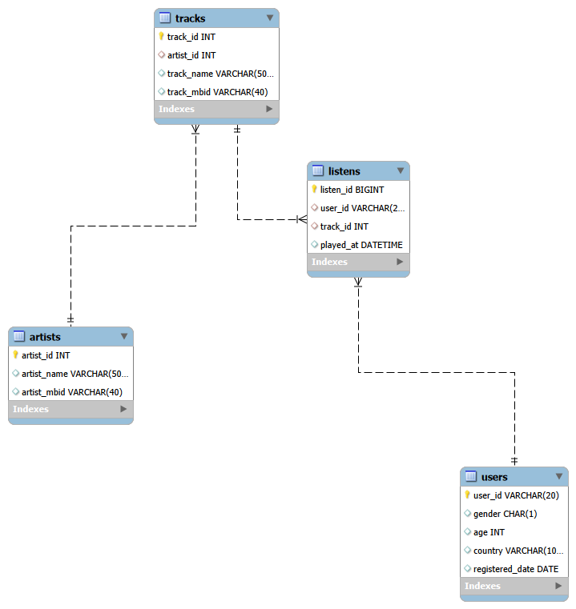
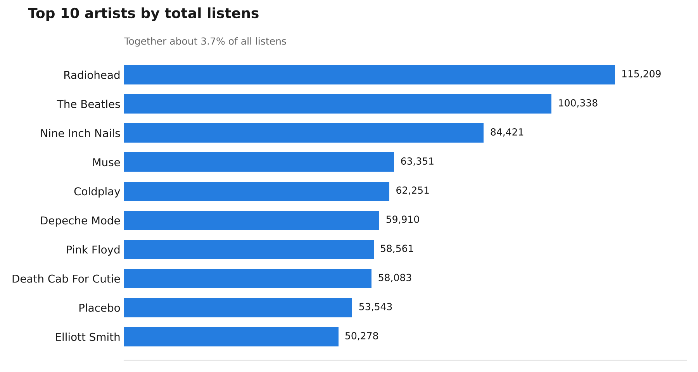
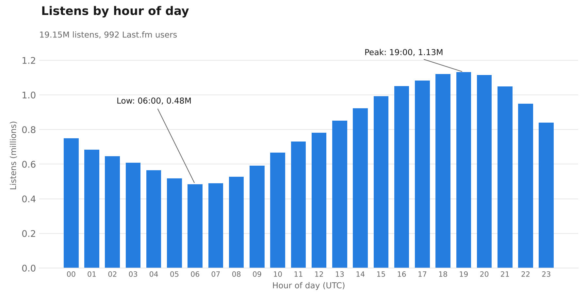

# Last.fm Listening History — SQL Analysis (MySQL)

An end-to-end SQL project: loading a raw 19M-row listening log into a normalized MySQL schema, and analyzing it with window functions, CTEs and sessionization.

**Stack:** MySQL 8, MySQL Workbench
**Data:** [Last.fm Dataset – 1K users](http://ocelma.net/MusicRecommendationDataset/lastfm-1K.html) (Celma, 2010). Listening events of 992 users, 2005–2009. Licensed for non-commercial use, so the raw data is not included in this repository.

## Schema

| Table | Rows | Notes |
|---|---|---|
| `users` | 992 | gender, age, country, registration date |
| `artists` | 173,783 | keyed by artist name |
| `tracks` | 1,498,453 | keyed by artist + track name |
| `listens` | 19,150,868 | one row per play: user, track, UTC timestamp |

## Pipeline

1. `01`–`02`: load the raw TSV files into `stg_` staging tables with `LOAD DATA LOCAL INFILE`.
2. `03`–`05`: normalize into `users`, `artists`, `tracks`, `listens` (ELT inside MySQL; empty strings converted to NULL, date strings parsed).
3. `06`: indexes and foreign keys, added after the bulk load for speed.
4. `07_analysis.sql`: the analysis queries below.

Note: file paths in the load scripts are machine-specific; edit them to your own folder.

## Analysis queries (`07_analysis.sql`)

| # | Question | Techniques |
|---|---|---|
| Q1 | Top 10 artists overall | joins, aggregation |
| Q2 | Top 3 artists per user | `DENSE_RANK`, `PARTITION BY` |
| Q3 | Listening by hour of day | `HOUR()`, grouping |
| Q4 | 7-day moving average of daily listens | `AVG() OVER (ROWS BETWEEN 6 PRECEDING AND CURRENT ROW)` |
| Q5 | Number of listening sessions per user | `LAG`, conditional flag, `SUM` |
| Q6 | Average listens per session (users with 100+ listens) | `LAG` + running `SUM OVER` for session ids |
| Q7 | Repeat-listen rate per user | `ROW_NUMBER` per user+track, `AVG(boolean)` |
| Q8 | Top artist per country: by listens (8a) and by distinct listeners (8b, countries with 10+ users) | CTEs, `DENSE_RANK`, `COUNT(DISTINCT)` |
| Q9 | Sensitivity of session count to the gap threshold | parameter sweep |

A session is a run of listens where consecutive plays are no more than 30 minutes apart.

## Findings

- **A long tail.** The most-played artist is Radiohead (115,209 listens), followed by The Beatles (100,338) and Nine Inch Nails (84,421). The top 10 artists together account for only about 3.7% of all 19.15M listens, spread across 173,783 artists.
- **Daily rhythm.** Listening peaks at 19:00 UTC (about 1.13M listens) and bottoms out at 06:00 UTC (about 484K), a ratio of roughly 2.3 to 1. Activity rises steadily from the early-morning low through the afternoon.

- **Session definition matters.** Total sessions: 1,142,833 (15-min gap), 901,709 (30-min), 739,901 (60-min). Average listens per session rises from about 16.8 to 21.2 to 25.9. Any session metric should be reported together with its threshold.
- **Top artist per country depends on the metric.** Ranking by total listens (Q8a) is dominated by single heavy users in small countries (e.g. one country's "top artist" is just one user's favorite). Counting distinct listeners with a 10-user minimum (Q8b) gives a more stable picture: Radiohead leads or ties in 8 of the 17 qualifying countries, including the US (169 listeners) and the UK (95).
- **Repeat-listen rate grows with activity.** The top 10 users by repeat rate (95%–98%) all have more than 23,000 listens, so the metric partly reflects how much a user listens. Comparisons should be made among users with similar activity.

## Limitations and design notes

- Activity is highly skewed: some users have only a handful of listens (one user has 12 listens in three years). Per-user metrics use a 100-listen minimum.
- One user (`user_000691`) averages about 485 listens per session, most likely a player left running in the background.
- Timestamps are UTC, so hour-of-day patterns are not local time.
- Artists are matched by name under a case- and accent-insensitive collation: 173,783 artists here vs. roughly 177K in the dataset documentation (about 2% merged). Tracks are keyed by artist + track name.
- `DENSE_RANK` keeps ties, so a country or user can return more than one top artist.
- The 7-day moving average (Q4) averages over the previous 7 rows, not 7 calendar days, so days without any listens are skipped.
- The data reflects Last.fm's early-adopter users from 2005–2009, not the general population of any country.

## How to run

1. Install MySQL 8 and create a database `music_project`.
2. Download the dataset and place the two TSV files in a local folder.
3. Enable local infile (`SET GLOBAL local_infile = 1;`, and `OPT_LOCAL_INFILE=1` in the connection settings).
4. Edit the file paths in `01`–`02`, then run the scripts in numeric order.
